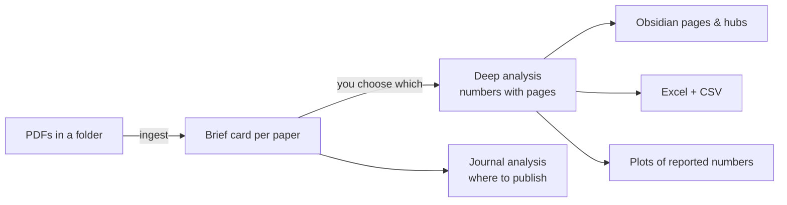

# paper-kb

**Turn a folder of research PDFs into a cited, cross-linked knowledge base — with Claude.**

For researchers in biomedical engineering, materials and chemistry, biology, mechanics and neighbouring fields who
read dozens to hundreds of papers on one topic and want to compare them part by part, number by number, without
losing track of where each number came from.



## What you get
- **One card per paper** (`records/<ID>.yaml`): what was done, what sets it apart, key findings — and every number with the page it comes from. Nothing is invented: missing information is written as `not reported`.
- **Brief first, deep on request.** All new papers get a short card; Claude then shows a table with a recommendation and waits until you pick which papers to analyse in depth.
- **Object deconstruction.** Whatever a paper builds or studies — a catheter, a hydrogel, an organoid model, a finite-element model — is taken apart into *elements*, *functions*, *links between elements* (mechanical, chemical, adhesive, thermal, electrical, fluidic, biological) and *interactions with the environment*. How a part is made is recorded in detail only when it is non-obvious or the point of the paper.
- **Pages to click through** (Obsidian): a note per paper with its figure and a structure graph; hubs per topic, lab, journal, element role, joining method, environment, preparation method, measured quantity; a *function × solution* table that shows what has and has not been tried.
- **Plots of the numbers** reported across papers (per quantity over years, property maps), only where values are comparable.
- **Measurement protocols** extracted on request — how exactly something was measured, side by side across papers, with a checklist for your own protocol.
- **Journal analysis**: which journals publish your topic, how often and when, open-access status and APC, citedness, the focus of the papers they publish — and a shortlist of where to submit.
- **Excel workbook** with every table, for those who prefer filters to graphs.

Your own notes in any generated page (below `📝 My notes`) are kept on every rebuild.

## Install
Works wherever Claude can run Python on your files: **Claude Code** in the terminal, in the **Claude desktop app (Code tab)** or in an IDE.

**As a plugin (recommended)** — in Claude Code:
```
/plugin marketplace add polilya/paper-kb
/plugin install paper-kb@paper-kb
```
**Or copy the skill**: put the folder `skills/paper-kb` into `~/.claude/skills/` (all projects) or into `<your project>/.claude/skills/` (one project).

Python packages (Claude will offer to install them): `pip install -r requirements.txt`.

New to AI tools? → **[docs/QUICKSTART.md](docs/QUICKSTART.md)** (10 minutes, no terminal needed).

## Use
Open your project folder in Claude Code and say, in any language:
- "Set up a paper database on robotic catheters" → a short interview, then a base adapted to your field.
- "Add the new papers" → brief cards for everything in the inbox + a table asking which to analyse in depth.
- "Analyse 2, 5 and 7 in depth" · "How did Smith2024 measure the modulus?" · "Compare the bending angle across papers" · "What has nobody tried?" · "Where should I publish this?"

How the base is organised, how categories and hubs are made and how to navigate them: **[docs/HOW-IT-WORKS.md](docs/HOW-IT-WORKS.md)**.
Limits, privacy and honest use: **[docs/FAQ.md](docs/FAQ.md)**.

## Field templates
`biomedical-devices`, `materials-chemistry`, `biology`, `mechanics-modelling` and an empty `_template`
(`skills/paper-kb/templates/domains/`). A template is only a start: during setup Claude proposes additions from your
first papers, and asks before adding any new term later. Contributions of templates for other fields are welcome.

## Engine without AI
`skills/paper-kb/scripts/kb.py` is plain Python: `ingest`, `stub`, `check`, `build`, `journals`, `figures`, `triage`, `peek`.
You can edit cards by hand and rebuild everything without Claude.

## Origin
Generalised from the literature database built for an MSc project on soft bioelectronic interfaces
(TU Eindhoven, 2026). Feedback and issues are very welcome.

## License
Code: MIT. If you use paper-kb in your research, please cite it (see `CITATION.cff`).
