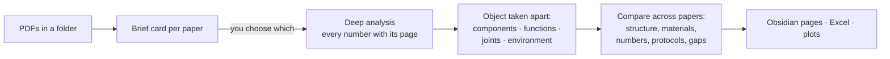
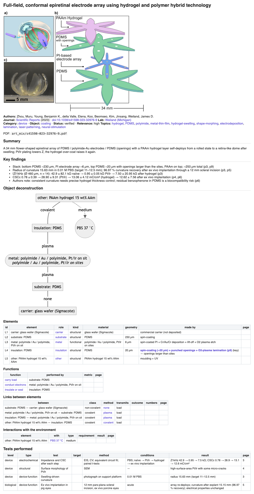
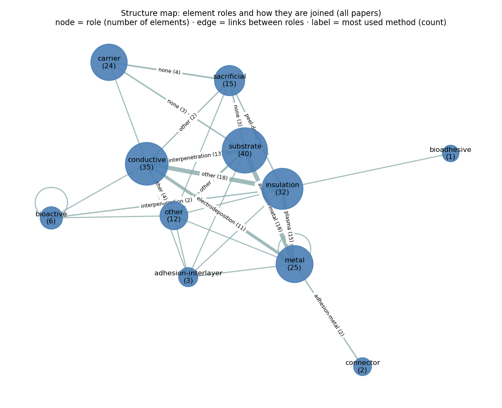

# paper-anatomy

**Take your research papers apart and compare them part by part — a cited, cross-linked knowledge base built from
your PDFs with Claude.**

For researchers in biomedical engineering, materials and chemistry, biology, mechanics and neighbouring fields who
read dozens to hundreds of papers on one topic and want to compare them part by part, number by number, without
losing track of where each number came from.



**→ See it on a real base: [visual tour](docs/EXAMPLE-bioelectronics.md)** (100 papers on soft bioelectronic interfaces)

<a href="docs/EXAMPLE-bioelectronics.md"></a>
<a href="docs/EXAMPLE-bioelectronics.md"></a>

## What you get
- **One card per paper** (`records/<ID>.yaml`): what was done, what sets it apart, key findings — and every number with the page it comes from. Nothing is invented: missing information is written as `not reported`.
- **Brief first, deep on request.** All new papers get a short card; Claude then shows a table with a recommendation and waits until you pick which papers to analyse in depth.
- **The studied object taken apart.** Whatever a paper builds or studies — a catheter, a thin-film electrode, a hydrogel, an organoid model, a finite-element model — is broken down into its *components*, their *functions*, the *joints* between them (mechanical, chemical, adhesive, thermal, electrical, fluidic, biological) and its *interactions with the environment*. How a component is made is recorded in detail only when it is non-obvious or the point of the paper. Which components exist in your field is defined with you during setup.
- **Comparison across papers**, generated from the cards:
  - *structure* — a map of which components meet which and how they are joined; interfaces by material pair; every use of a joining method and whether it held;
  - *materials* — every implementation of a component role with material, dimensions, how it was made and reported properties;
  - *function × solution* — what has been tried for each function, and the empty cells nobody has tried;
  - *numbers* — plots of each reported quantity across papers and years, property maps (only comparable values);
  - *methods* — measurement protocols side by side (on request), with a checklist for your own protocol.
- **Pages to click through** in Obsidian (paper pages and hubs, graph view), an **Excel workbook** with every table, CSV files.
- **Also**: labs and lines of work, design rules, process windows, review maps, and a journal analysis (where the topic is published, open access, a shortlist of where to submit).

Your own notes in any generated page (below `📝 My notes`) are kept on every rebuild.

## Install
Works wherever Claude can run Python on your files: **Claude Code** in the terminal, in the **Claude desktop app (Code tab)** or in an IDE.

**As a plugin (recommended)** — in Claude Code:
```
/plugin marketplace add polilya/paper-anatomy
/plugin install paper-anatomy@paper-anatomy
```
**Or copy the skill**: put the folder `skills/paper-anatomy` into `~/.claude/skills/` (all projects) or into `<your project>/.claude/skills/` (one project).

Python packages (Claude will offer to install them): `pip install -r requirements.txt`.

New to AI tools? → **[docs/QUICKSTART.md](docs/QUICKSTART.md)** (10 minutes, no terminal needed).

## Use
Open your project folder in Claude Code and talk to it in any language. Start with **"Set up a paper database on
<your topic>"** — a short interview follows, then a base adapted to your field. Then **"Add the new papers"** — brief
cards for everything in the inbox and a table asking which ones to analyse in depth (e.g. "2, 5 and 7").

Examples of what to ask, by field:

| Field | Set up | Then ask |
|---|---|---|
| Medical robotics | "…on tendon-driven robotic catheters for endovascular navigation" | "Compare tip bending angle and tip force across papers" · "How are the pull wires anchored, and which anchoring failed?" · "Which designs were tested in vivo, not only in phantoms?" |
| Wearables / sensors | "…on sweat sensors for continuous glucose monitoring" | "Which sensors were validated against blood glucose, with how many subjects?" · "How is the sensing layer bonded to the patch?" |
| Materials / chemistry | "…on self-healing conductive hydrogels" | "Plot conductivity against Young's modulus" · "Which healing chemistries work under water?" · "Write out how Smith2024 measured healing efficiency" |
| Tissue engineering / biology | "…on maturation of iPSC-derived cardiomyocytes on soft substrates" | "Which substrate stiffness ranges were tested and what readouts changed?" · "Build a culture protocol checklist from the three most relevant papers" |
| Mechanics / modelling | "…on hyperelastic and poroelastic models of brain tissue" | "Which constitutive models and parameters are used, at what strain rates?" · "Which models were validated against experiments?" |
| Any field | — | "What has nobody tried yet?" · "Which labs work on this and who builds on whom?" · "Which journals publish this, and where should I submit my paper?" · "Explain how this base works" |

**See every step on a real base:** [visual tour](docs/EXAMPLE-bioelectronics.md) — brief cards and triage, a paper
page, the structure map, materials per component, function × solution, numbers, protocols, Excel, graph of nodes.

**Before you start:** which subscription, which model and effort per step, how many papers per 5-hour window, Obsidian
and Zotero → [docs/RECOMMENDATIONS.md](docs/RECOMMENDATIONS.md).

How the base is organised, how categories and hubs are made and how to navigate them: **[docs/HOW-IT-WORKS.md](docs/HOW-IT-WORKS.md)**.
Limits, privacy and honest use: **[docs/FAQ.md](docs/FAQ.md)**.

## Field templates
`biomedical-devices`, `materials-chemistry`, `biology`, `mechanics-modelling` and an empty `_template`
(`skills/paper-anatomy/templates/domains/`). A template is only a start: during setup Claude proposes additions from your
first papers, and asks before adding any new term later. Contributions of templates for other fields are welcome.

## Engine without AI
`skills/paper-anatomy/scripts/kb.py` is plain Python: `ingest`, `stub`, `check`, `build`, `journals`, `figures`, `triage`, `peek`.
You can edit cards by hand and rebuild everything without Claude.

## Origin
Generalised from the literature database built for an MSc project on soft bioelectronic interfaces
(TU Eindhoven, 2026). Feedback and issues are very welcome.

## License
Code: MIT. If you use paper-anatomy in your research, please cite it (see `CITATION.cff`).
