# A visual tour — one real base, step by step

paper-anatomy is about **reading papers and taking them apart**: short cards for everything, deep analysis of the
papers that matter, the studied objects broken down into their components, and comparisons across papers. This
tour walks through every step on a real base: **100 papers on soft bioelectronic interfaces** (conductive polymers,
hydrogels and thin-film devices for neural interfaces), built during an MSc project at TU Eindhoven (2026).
All pictures below are generated by `kb.py build` from that base.

> **Your field will have its own components.** Here, devices are thin-film stacks, so the structure analysis is about
> *layers*, their *materials* and how each layer *adheres* to the next. For a robotic catheter the same analysis finds
> the shaft, braid, pull wires, tip and actuator, and how they are welded, reflowed, glued or crimped; for a hydrogel —
> polymer, crosslinker, filler and their bonds; for an organoid model — cell types, matrix, medium and stimuli. You
> describe your field once during setup; the skill then finds these components in each of your papers.

| | |
|---|---|
| papers | 100 — 79 analysed in depth, 21 brief |
| components (elements) recorded | 195, joined by 117 links |
| tests | 531, each with level, method, conditions, result, page |
| numbers | 413, each with unit, condition and page |
| measurement protocols | 28 |

---

## 1. Brief cards for everything, then you choose
After `Add the new papers`, every PDF gets a short card (bibliography from OpenAlex, category, tags, one-line
summary, relevance). Claude then shows a table like this and **waits** for your choice:

| # | paper | year | category | relevance | pages | recommendation |
|---|---|---|---|---|---|---|
| 1 | ChaoCorreas2026 | 2026 | simulation | high | 20 | deep — model of drying gels, parameters reusable |
| 2 | Rahman2025 | 2025 | device | high | 12 | deep — swelling, conductivity and moduli in PBS |
| 3 | Wang2025b | 2025 | review | high | 36 | deep (review map) — mine its references |
| … | | | | | | |
| 20 | Zhao2021 | 2021 | material | low | 11 | keep brief — graphene, outside the material class |

## 2. Deep analysis → one page per paper
Figure, key findings with pages, **the object taken apart** (graph of components and how they are joined), tables
of elements, functions, links, environment and every test.

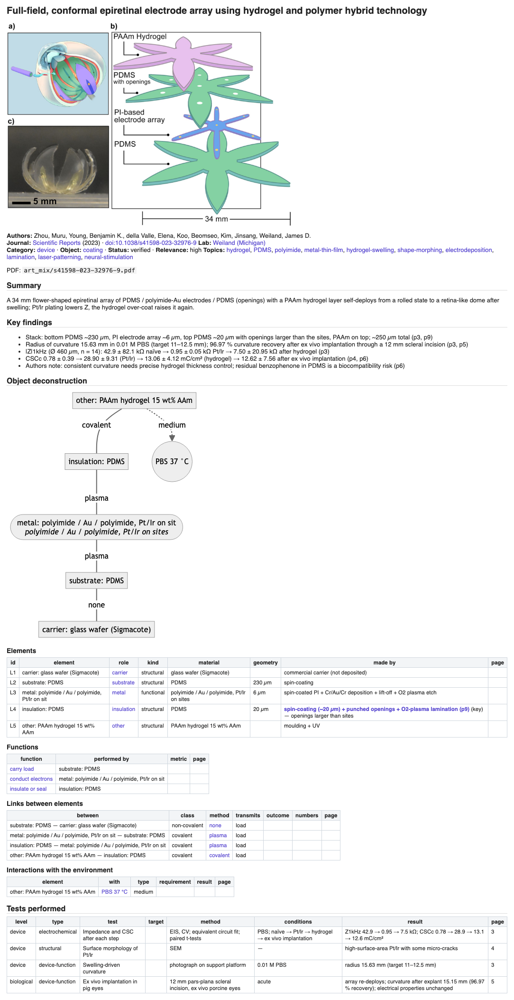

Figure on the page: Zhou et al., Sci. Rep. 13, 2023, doi:10.1038/s41598-023-32976-9, CC BY 4.0.

## 3. Structure across all papers
**Structure map** — which components meet which, and the most used joining method (all 100 papers at once):

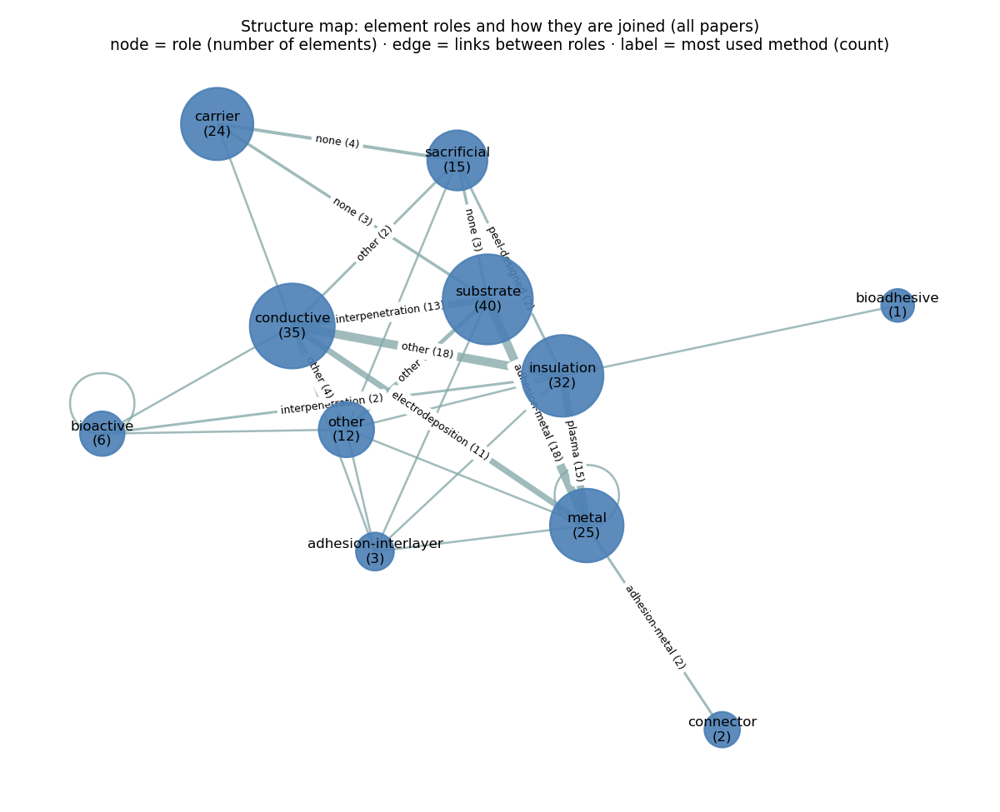

**Interfaces by material** — every pair of materials that touch, how they were joined, in which papers:

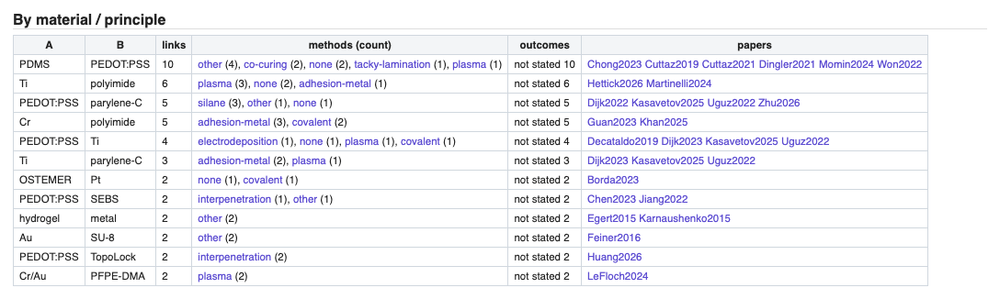

**One joining method across papers** — here *silane*: on which materials, with which preparation:

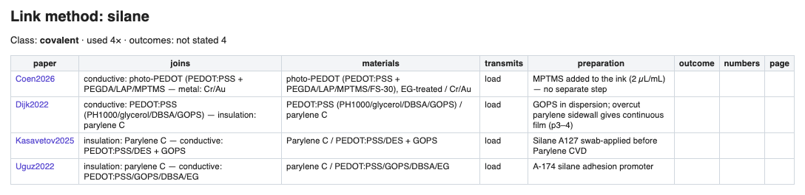

## 4. Material data per component
Every implementation of one component role — here *insulation* — with material, thickness, how it was made and the
properties the papers report (mechanical, electrical, swelling, biological, with pages):

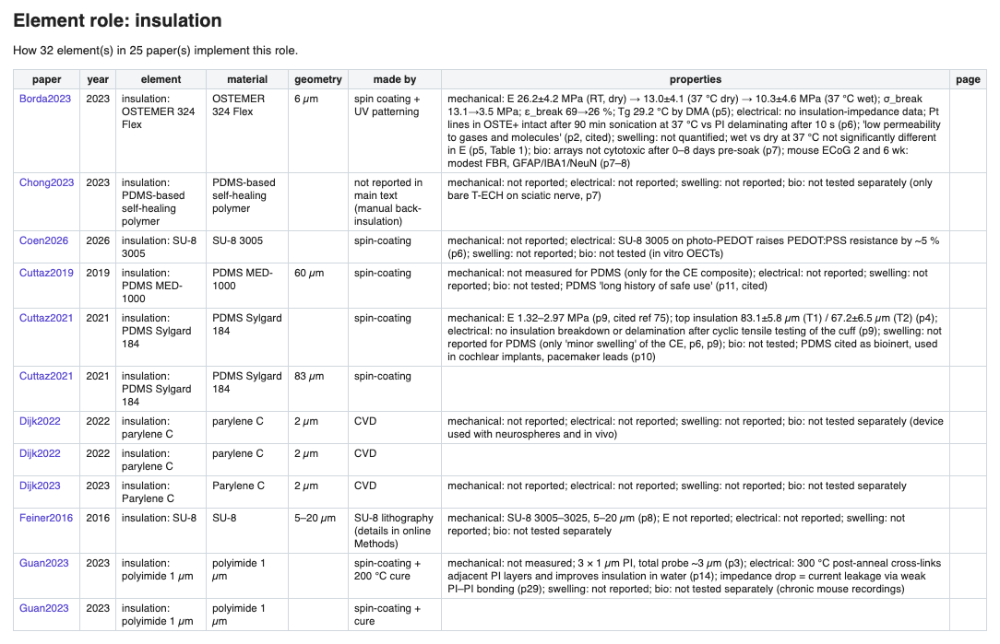

## 5. What has been tried for each function — and what has not
Rows: what the object must do. Columns: solution variants (material class or working principle). **Empty cells are
combinations nobody in the base has tried** — a quick way to find gaps:

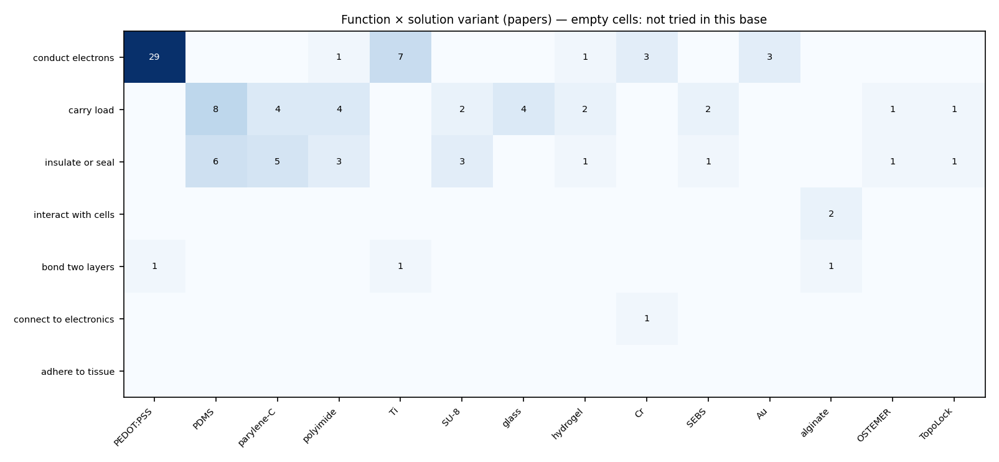

## 6. Numbers across papers
Every reported value of a quantity, by year and paper type (only comparable values; the table beside it on the
page gives the condition and page of each point):

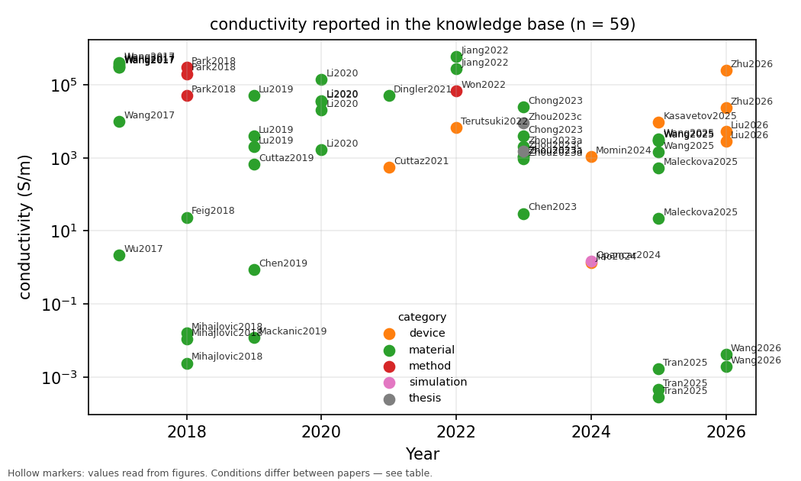

Property maps — one point per paper — show trade-offs of the field (here: soft vs conductive):

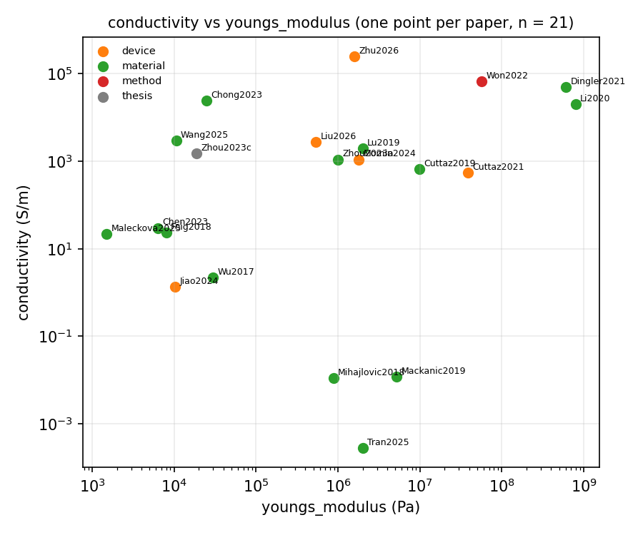

## 7. How exactly was it measured? Protocols side by side
On request, the measurement method of a paper is written out step by step. The protocol page compares papers and
starts with a checklist of what your own protocol must state:

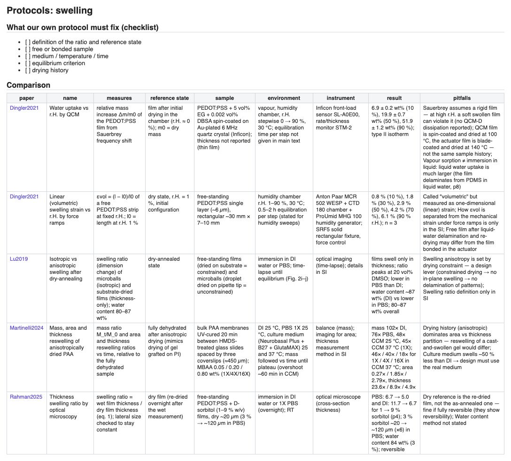

## 8. Everything as tables
`knowledge_base.xlsx` — sheets Papers, Elements, Functions, Links, Interactions, Tests, Metrics, Protocols, Design
rules, Process windows, Journals, Relations. Filter and sort like any spreadsheet:

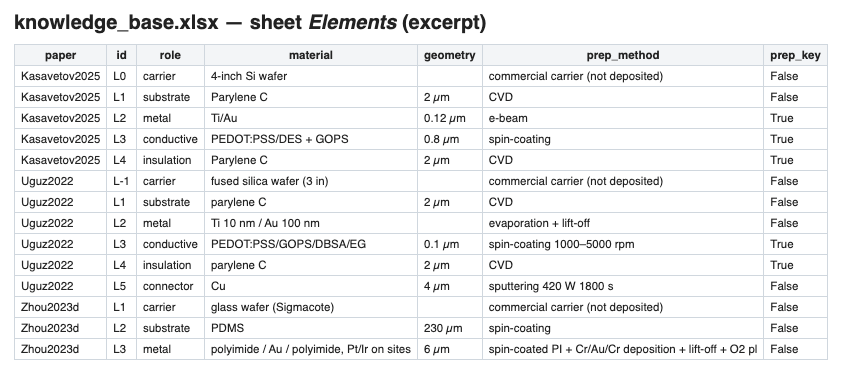

## 9. Map of nodes
Papers (grey) connected through component roles, joining methods, functions and topics — the network you can
explore in Obsidian's graph view:

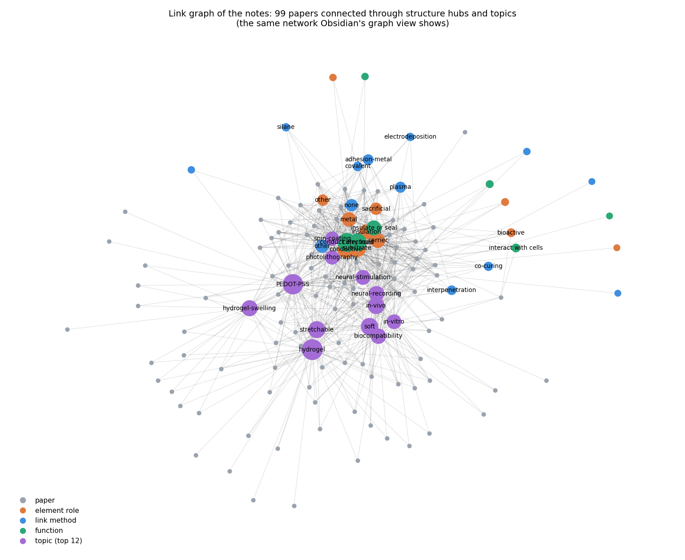

## Also
- **Labs and lines of work** — who works on what, shared authors, which paper builds on which.
- **Design rules** (material papers: variable → effect), **process windows** (method papers), **review maps** (reviews: taxonomy, consensus, what to read next).
- **Journal analysis** — which journals publish the topic, open-access status, citedness, a shortlist of where to submit.

## What it was used for in this project
- Choosing the insulation and the adhesion strategy of a prototype from what held in wet conditions in other devices.
- Comparing conductivity and stiffness of soft conductors — and noticing how often the measured state (dry / swollen) is not reported.
- Writing our own swelling and mechanics protocols from the side-by-side protocol pages.
- Reading fully only the relevant third of the papers.

*Note: the original base was built before the general schema; its layer tables were converted automatically into
elements and links for this tour (whether each joint held was not recorded there). The project's own notes and
unpublished ideas are not shown.*
