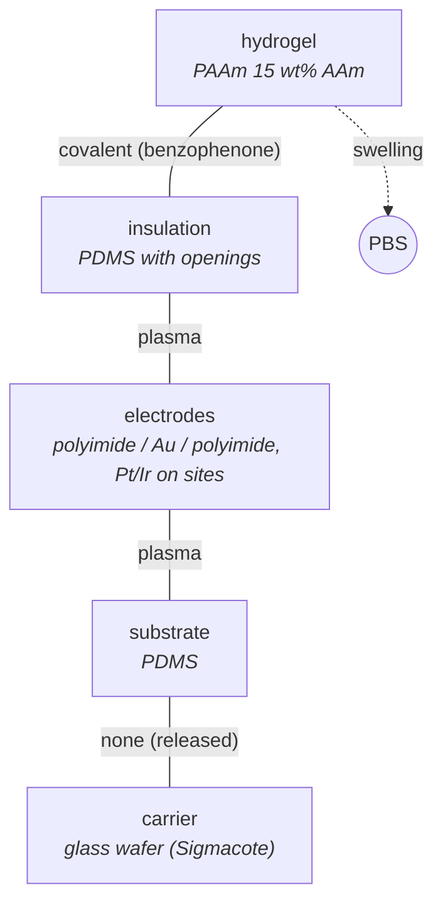
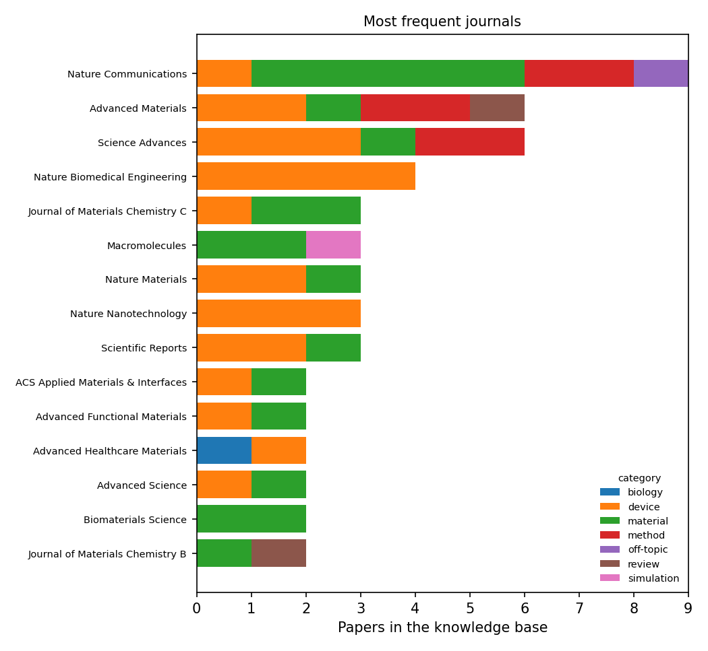
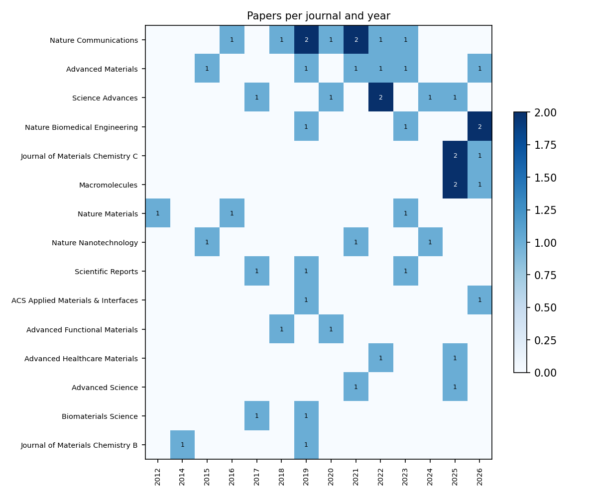

# How it looks in practice — a base on soft bioelectronic interfaces

The base paper-kb was generalised from: an MSc project at TU Eindhoven (2026) on soft conductive materials and
devices for neural interfaces. Built over about two months alongside the project. Plots below were generated by
`kb.py build` from these cards.

## In numbers
| | |
|---|---|
| papers | 100 (79 verified, the rest brief) |
| journals | 58 |
| tests recorded | 531, each with level (material / device / biological / model), method, conditions, result, page |
| measurement protocols | 28 (conductivity, swelling, mechanics, coupled measurements) |
| hub pages | ~300 (topics, labs, people, materials, methods, layers, adhesion methods, design rules, protocols, lineages of work) |

## A card (excerpt)
Every number points to a page of the PDF.
```yaml
id: Zhou2023d
status: verified
doi: 10.1038/s41598-023-32976-9
title: Full-field, conformal epiretinal electrode array using hydrogel and polymer hybrid technology
year: 2023
journal: Scientific Reports
category: device
summary: A 34 mm flower-shaped epiretinal array of PDMS / polyimide-Au electrodes / PDMS (openings) with a PAAm
  hydrogel layer self-deploys from a rolled state to a retina-like dome after swelling; Pt/Ir plating lowers Z,
  the hydrogel over-coat raises it again.
key_findings:
- 'Stack: bottom PDMS ~230 µm, PI electrode array ~6 µm, top PDMS ~20 µm with openings larger than the sites, PAAm
  on top; ~250 µm total (p3, p9)'
- '|Z|1kHz (Ø 460 µm, n = 14): 42.9 ± 82.1 kΩ naïve → 0.95 ± 0.05 kΩ Pt/Ir → 7.50 ± 20.95 kΩ after hydrogel (p3)'
metrics:
- {quantity: csc, value: 13.06, unit: mC/cm2, condition: "cathodic CSC, Pt/Ir + hydrogel coat, n = 14", page: 4}
tests:
- name: Impedance and CSC after each step
  level: device
  type: electrochemical
  method: EIS, CV; equivalent circuit fit; paired t-tests
  conditions: PBS; naïve → Pt/Ir → hydrogel → ex vivo implantation
  result: Z1kHz 42.9 → 0.95 → 7.5 kΩ; CSCc 0.78 → 28.9 → 13.1 → 12.6 mC/cm²
  page: 3
```

## The structure of the device, as drawn on its page
A layered device (topology *stack*): elements are layers, links say how each layer holds to the one below.


## Numbers across papers
Conductivity reported by every paper of the base, by year and category (log scale; conditions of each value are in the table on the quantity page):


A property map — one point per paper — shows the classic trade-off of the field (soft vs conductive):


## Journals
Where the topic is published, by category of the paper, and when:




The *Journals* page adds open-access status, APC, OpenAlex citedness and a shortlist of where to submit.

## What it was used for
- Comparing conductivity and stiffness of soft conductors across hydration states — and seeing how often the state (dry / swollen) is not reported.
- Choosing the insulation and adhesion strategy of a prototype from the *layer* and *adhesion* hubs (what held in wet conditions, with numbers).
- Writing our own measurement protocols for swelling and mechanics from the side-by-side *protocol* pages.
- Mapping labs and lines of work (who builds on whom) before contacting groups.
- Picking the papers to read fully: brief cards for everything first, deep analysis only for the relevant third.

The project's own notes, conclusions and unpublished ideas are not part of this example.
